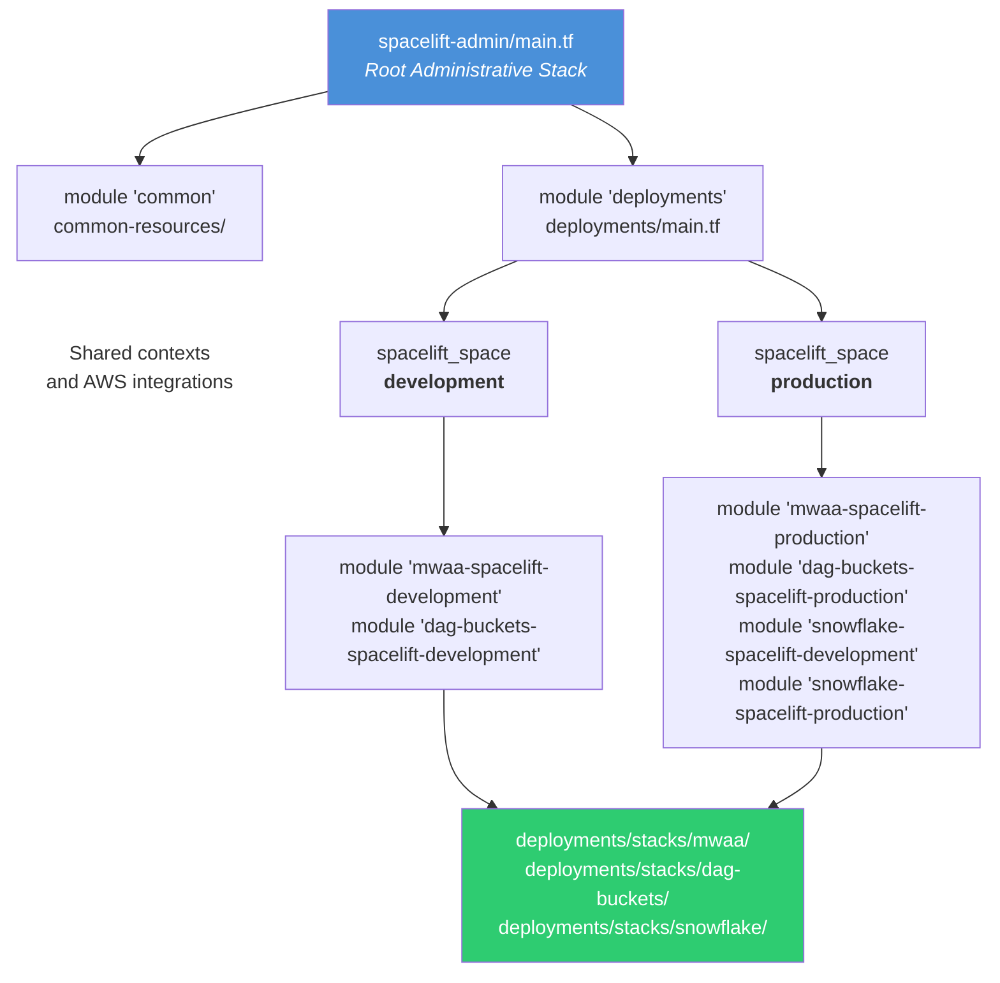

# Purpose

This repo manages cloud infrastructure deployed to AWS via [Spacelift](https://spacelift.io/) CI/CD using [OpenTofu](https://opentofu.org/): the Amazon MWAA (Managed Airflow) environments, the S3 buckets that the orca-recipes DAGs write to, and the S3 buckets that store Synapse RDS snapshots for Snowflake.

## Directory Structure
```
eks-stack/
  spacelift-admin/             # Root Spacelift administrative stack (its project root)
  common-resources/            # Shared Spacelift contexts, AWS integrations
  deployments/
    main.tf                    # Wires spacelift pipeline configs per environment (dev/prod)
    config/                    # Values that more than one stack reads
    spacelift/                 # CI pipeline definitions (HOW things get deployed)
      mwaa/                    # Pipeline config for the MWAA stacks
      dag-buckets/             # Pipeline config for the DAG buckets stacks
      snowflake/               # Pipeline config for the Snowflake RDS snapshot stacks
    stacks/                    # Cloud resource definitions (WHAT gets deployed)
      mwaa/                    # MWAA environment and its VPC
      dag-buckets/             # S3 buckets that the orca-recipes DAGs write to
      snowflake/               # S3 bucket for Synapse RDS snapshots
  modules/                     # Reusable Terraform modules
```

## Prerequisites

Before modifying modules, stacks, or configs:

1. **Spacelift access** — Request access to the [Spacelift UI](https://sagebionetworks.app.spacelift.io/) from Lingling or Bryan
2. **AWS SSO** — Configure SSO profiles for the target AWS accounts
3. **OpenTofu** — Install [OpenTofu](https://opentofu.org/docs/intro/install/) for local development/testing

## Development Guidelines

### Where a Stack's Values Live

- **MWAA and DAG buckets**: in `deployments/stacks/<name>/environments.tf`, and in `deployments/config/` for values that both stacks read. A pull request's proposed run plans the change on the stack it changes, and that stack's run applies it. The dev stacks allow run promotion: promote the proposed run to apply a branch to dev before merging. The prod stacks only apply `main`.
- **Snowflake**: in `deployments/main.tf`. The root admin stack writes them to the stacks as `TF_VAR_*` environment variables, and it tracks `main`, so a value reaches a stack only after the merge and a confirmed admin run. Then trigger the stack's run by hand: a changed environment variable does not trigger it. A proposed run on a pull request plans with the values already on the stack.

## How Deployment Works

Deploying a resource involves a **two-step process**:

1. **`deployments/spacelift/<name>/`** defines the **CI pipeline** in Spacelift. This controls _which_ stacks can be deployed, to _which_ AWS account, and _which_ file changes trigger them. Think of this as the build server job configuration.

2. **`deployments/stacks/<name>/`** defines **what cloud resources** are provisioned when that pipeline runs. Each stack is a Terraform root module that typically sources reusable modules from `modules/`. Think of this as the infrastructure blueprint.

When Spacelift runs a pipeline, it executes `tofu plan/apply` against the corresponding stack directory.

A push triggers a stack only when it changes a file that the stack's plan reads: a file under its `project_root`, or one matching its `additional_project_globs` (the modules it sources, and `deployments/config/` if it reads it). The root admin stack's project root is `spacelift-admin/`, so it runs only for changes to the Spacelift resources. Every stack has `autodeploy = false`, so nothing is applied until someone confirms the run.

### Architecture Diagram



## When to Add a Module vs. Create a New Stack

| Scenario | Where to Add | Example |
|----------|--------------|---------|
| Airflow configuration for the MWAA environments | `modules/mwaa/`, or `deployments/stacks/mwaa/environments.tf` for a value that differs between dev and prod | `core.max_map_length` |
| S3 bucket that a DAG writes to | The `dag_buckets` output in `deployments/config/outputs.tf`. See the [DAG buckets README](./deployments/stacks/dag-buckets/README.md) | Croissant metadata buckets |
| Independent resource with its own deployment lifecycle | Create a new stack (follow "Adding a New Stack" below) | Standalone SES config, separate API Gateway |

**Rule of thumb:** If your resource needs to be deployed or destroyed independently from the existing stacks, create a new stack.

## Adding a New Stack

Follow these steps to add a new independently-deployed resource:

### 1. Create the Terraform module

Create a new directory in `modules/<your-module>/` with at minimum:
- `main.tf` - the cloud resources to create
- `variables.tf` - configurable inputs
- `outputs.tf` - values other stacks may need
- `versions.tf` - required providers

See the [modules README](./modules/README.md) for guidelines.

### 2. Create the deployment stack

Create a new directory in `deployments/stacks/<your-stack>/` with:
- `main.tf` - sources your module: `source = "../../../modules/<your-module>"`
- `environments.tf` - every value the stack deploys, keyed by `deployment_environment`. See `deployments/stacks/mwaa/environments.tf`
- `variables.tf` - only `deployment_environment`, passed as `TF_VAR_deployment_environment` from Spacelift
- `outputs.tf` - values to export
- `provider.tf` - AWS provider configuration
- `versions.tf` - required providers and OpenTofu version

### 3. Create the Spacelift pipeline config

Create a new directory in `deployments/spacelift/<your-stack>/` with:
- `main.tf` - defines:
  - `spacelift_space` - a logical grouping in Spacelift
  - `spacelift_stack` - points `project_root` to your stack directory. `additional_project_globs` lists every file outside it that the plan reads: the modules it sources, and `deployments/config/*.tf` if it reads it. Set `autodeploy = false`, `protect_from_deletion = true`, and `allow_run_promotion = false` for prod
  - `spacelift_environment_variable` - sets `TF_VAR_deployment_environment`, the stack's only input
  - `spacelift_aws_integration_attachment` - binds AWS credentials
- `variables.tf` - inputs from the parent module
- `outputs.tf` - stack IDs for reference
- `versions.tf` - Spacelift provider


### 4. Wire it into `deployments/main.tf`

Add a `module` block in `deployments/main.tf` that sources your new spacelift config and passes the required variables (`parent_space_id`, `aws_integration_id`, `git_branch`, `deployment_environment`, etc.).

### 5. Commit, PR, merge

Once merged to `main`, confirm the root administrative stack's run, which creates the new Spacelift stacks. Then trigger each new stack's first run: a new stack does not run until a file it reads changes again.

### 6. View your new resources

To see your newly created stacks and monitor deployments:

- **Spacelift UI** — Log into the [Spacelift UI](https://sagebionetworks.app.spacelift.io/) to view stacks, runs, and logs. As of February 2026, a common DPE team account has not been created — contact Lingling or Bryan for access.
- **AWS Console** — Log into the [AWS Console via JumpCloud](https://console.jumpcloud.com/userconsole#/) for the target account to view the deployed cloud resources directly.

## Modules

Reusable Terraform modules in `modules/`:

**AWS Infrastructure**
- `mwaa` - Amazon MWAA (Managed Airflow) environment and its execution role
- `s3-bucket` - S3 bucket with optional public access
- `snowflake-s3-bucket` - S3 bucket for Synapse RDS snapshots that Snowflake reads

**API and Messaging**
- `aws-api-gateway` - API Gateway resources
- `aws-sqs` - Simple Queue Service

**CI/CD**
- `spacelift-private-worker` - Spacelift private worker setup

---

## Deleting a Stack

Deleting a Spacelift stack also deletes its Spacelift-managed state. Whether the stack's cloud resources are destroyed depends on how the stack is deleted. Reference: [Delete a stack in Spacelift](https://docs.spacelift.io/concepts/stack/creating-a-stack#delete-a-stack-in-spacelift).

1. Set `protect_from_deletion = false` on the stack in `deployments/spacelift/<name>/main.tf`, merge, and confirm the admin stack's run. While it is `true`, any attempt to delete the stack fails ([provider docs](https://github.com/spacelift-io/terraform-provider-spacelift/blob/main/docs/resources/stack.md)).
2. Destroy the resources. Pick one:
   - Run `tofu destroy -auto-approve` as a [task](https://docs.spacelift.io/concepts/run/task) on the stack, then check that the task destroyed everything.
   - Or delete the stack in the UI (**Settings** → **Stack deletion**) and choose to delete the stack's resources. That removes the stack, so do step 3 right after, or the next admin run creates the stack again.
3. Remove the module call from `deployments/main.tf`, merge, and confirm the admin stack's run. The admin stack deletes the stack, its environment variables and its AWS integration attachment.

Removing the module call by itself does not destroy the stack's resources. The admin stack deletes the stack and its state, and the AWS resources stay behind with no state tracking them. These stacks have no [`spacelift_stack_destructor`](https://github.com/spacelift-io/terraform-provider-spacelift/blob/main/docs/resources/stack_destructor.md), the resource that runs a destroy before deleting the stack.

To keep a resource that the stack manages (for example, a bucket with data), take it out of the stack's state with `tofu state rm` in a task before step 2. Then neither delete method destroys it.

---

## Spacelift Setup

### Connecting a New AWS Account

Reference: <https://docs.spacelift.io/integrations/cloud-providers/aws#setup-guide>

1. Create a new IAM role (e.g., `spacelift-admin-role`) with description: "Role for Spacelift CI/CD to assume when deploying resources managed by Terraform"
2. Use this custom trust policy:

```json
{
    "Version": "2012-10-17",
    "Statement": [
        {
            "Effect": "Allow",
            "Principal": {
                "AWS": "arn:aws:iam::324880187172:root"
            },
            "Action": "sts:AssumeRole",
            "Condition": {
                "StringLike": {
                    "sts:ExternalId": "sagebionetworks@*"
                }
            }
        },
        {
            "Effect": "Allow",
            "Principal": {
                "AWS": "arn:aws:iam::{{AWS ACCOUNT ID}}:root"
            },
            "Action": "sts:AssumeRole"
        }
    ]
}
```

3. Attach these policies to the role:
   - `PowerUserAccess`
   - An inline policy for IAM operations (needed if Terraform creates/edits/deletes IAM roles/policies):

```json
{
    "Version": "2012-10-17",
    "Statement": [
        {
            "Effect": "Allow",
            "Action": [
                "iam:*Role",
                "iam:*RolePolicy",
                "iam:*RolePolicies",
                "iam:*Policy",
                "iam:*PolicyVersion",
                "iam:*OpenIDConnectProvider",
                "iam:*InstanceProfile",
                "iam:ListPolicyVersions",
                "iam:ListOpenIDConnectProviders",
                "iam:UpdateOpenIDConnectProviderThumbprint",
                "iam:ListGroupsForUser",
                "iam:ListAttachedUserPolicies"
            ],
            "Resource": "*"
        },
        {
            "Effect": "Allow",
            "Action": [
                "iam:CreateUser",
                "iam:AttachUserPolicy",
                "iam:ListPolicies",
                "iam:TagUser",
                "iam:GetUser",
                "iam:DeleteUser",
                "iam:CreateAccessKey",
                "iam:ListAccessKeys",
                "iam:DeleteAccessKey"
            ],
            "Resource": "arn:aws:iam::{{AWS ACCOUNT ID}}:user/smtp_user"
        }
    ]
}
```

4. Add a new `spacelift_aws_integration` resource to the `common-resources/aws-integrations` directory.
